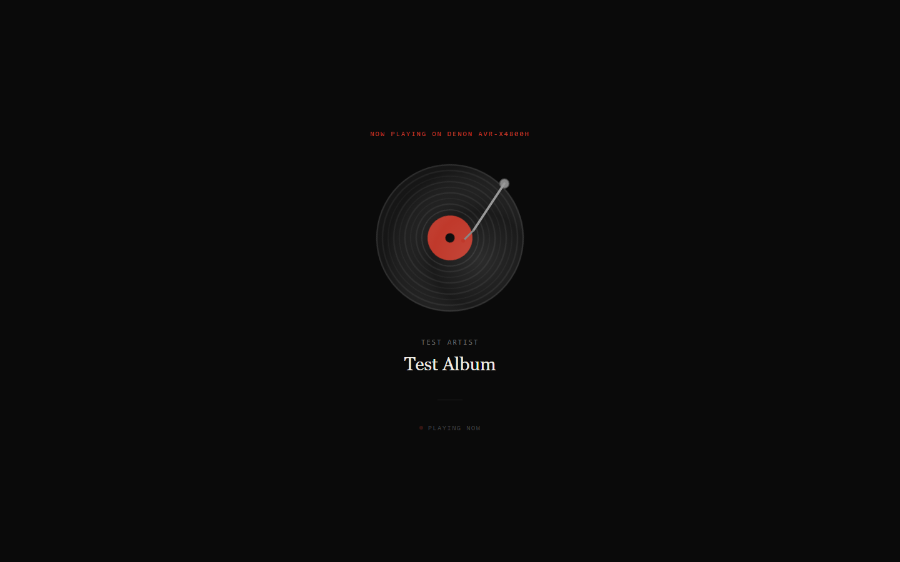
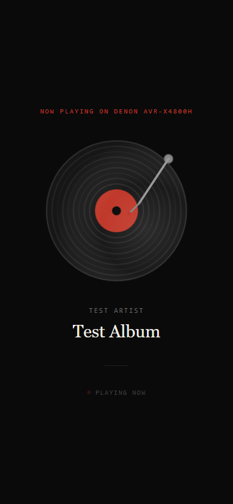

# VinylNFCTagging

Tap an NFC tag on a vinyl record and the album starts playing — a static
GitHub Pages front end that fires a Home Assistant webhook and shows a
now-playing page with synced lyrics.





## Why

The records are already catalogued and the player is already smart. This
repo is the thin glue between them: each record gets an NFC tag holding a
URL, and tapping it with a phone is the whole interface — no app, no
account, nothing to log into.

## How it works

1. Each NFC tag is written with a Pages URL carrying the album in its
   query string, e.g.
   `?artist=…&album=…&track=…&dur=…&art=…&webhook=…`
2. `index.html` opens, displays the now-playing page (spinning record,
   album art on the label, artist and album), and — if a `webhook`
   parameter was supplied — POSTs to that Home Assistant cloud webhook
   half a second after load, which starts playback on the receiver.
3. Lyrics are fetched in the browser from [lrclib.net](https://lrclib.net)
   and highlighted in sync when timed lyrics exist; a `lyrics` parameter
   still works as a manual override.

## What's in the repo

| File | What it does |
|---|---|
| `index.html` | The tag landing page. Reads the query parameters, shows now playing, fires the webhook, syncs lyrics. Shows an error page if `artist`/`album` are missing. |
| `nowplaying.html` | A large-format now-playing display, built for a TV screen. |
| `<album>.html` (for example `armedultrapoplive.html`) | Per-album shortcut pages: a tiny auto-submitting form that POSTs straight to that album's Home Assistant webhook, no parameters needed. |
| `hue-sync/album_hue_sync.py` | Polls the Denon / Music Assistant player in Home Assistant; while music plays it extracts a palette from the album art and animates it across the TV lights, restoring the lights to their previous state when playback stops. |
| `error.jpg` | Image shown on the error page. |

## Tag URL parameters (`index.html`)

| Parameter | Required | What it does |
|---|---|---|
| `artist` | yes | Artist name, shown on the page and used for the lyrics lookup. |
| `album` | yes | Album name, shown on the page and used for the lyrics lookup. |
| `track` | no | Song title; enables the lrclib lyrics lookup. |
| `dur` | no | Track duration in seconds; improves the lyrics match. |
| `webhook` | no | Home Assistant cloud webhook ID; fired on load when present. |
| `art` | no | Album-art image URL, shown on the record label. |
| `lyrics` | no | Lyrics text to display instead of fetching them. |
| `t` | no | Start offset in seconds for lyrics sync. |

## Hue sync

```bash
HA_TOKEN=<your Home Assistant long-lived token> python3 hue-sync/album_hue_sync.py
```

The token is read from the `HA_TOKEN` environment variable and is never
hardcoded. The Home Assistant base URL, player entity, and light list can
be overridden with `HA_BASE`, `HUE_PLAYER`, and `HUE_LIGHTS`. Pressing
Ctrl-C restores the lights on the way out.

## Notes

- Everything here is static HTML/CSS/JS plus one Python script — there is
  no build step and no server component in this repo; GitHub Pages serves
  it as-is.
- Webhook IDs are effectively passwords: anyone who can fire one can
  start playback. Treat tag URLs the way you'd treat a house key.

## Roadmap

- [ ] Generate the per-album shortcut pages from the collection sheet
      instead of writing them by hand

## License

No license has been selected for this project; all rights reserved
by default.
